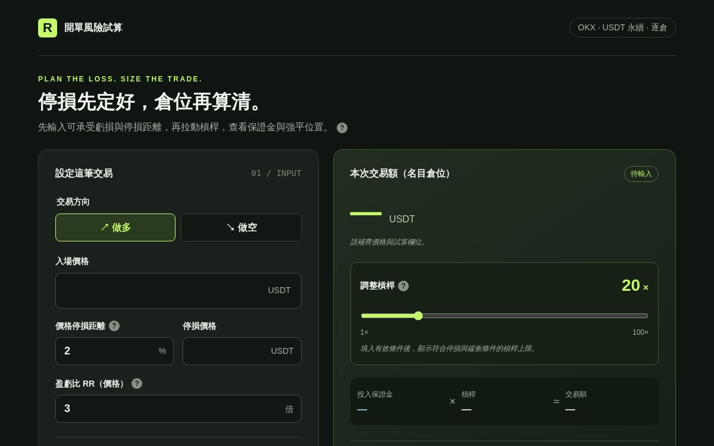
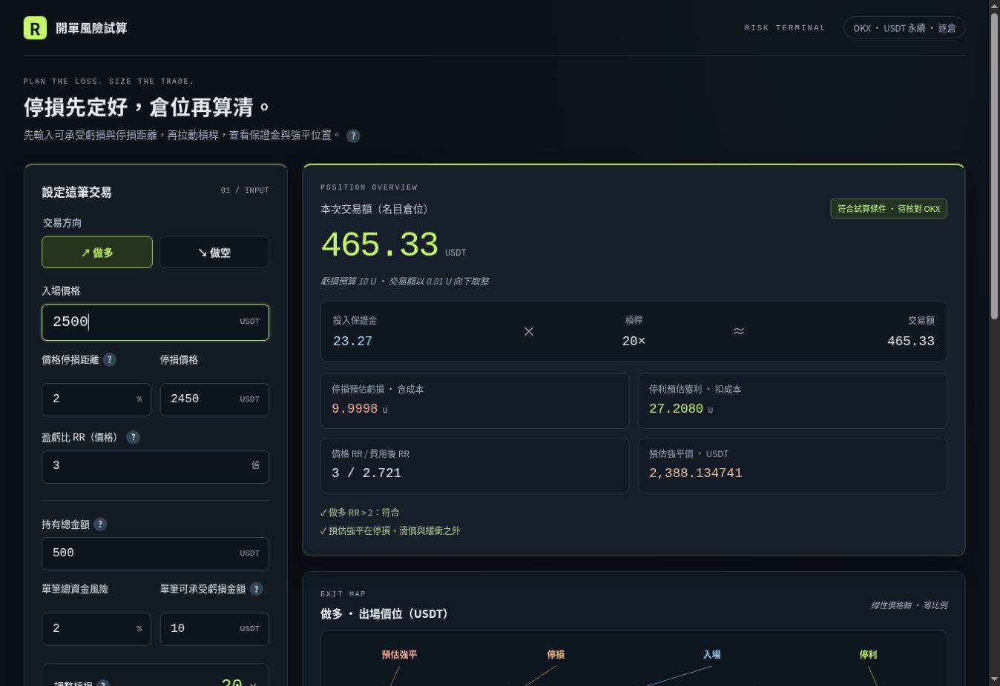

# Dashboard UI 修改與驗證紀錄

日期：2026-10-12。GitHub 公開儲存庫及網頁設定已取得使用者授權。

## 完成的程式修改

| 檔案 | 修改原因 |
| --- | --- |
| `dist/index.html` | 左側集中交易參數與槓桿；右側結果、EXIT MAP、資金分配；新增估算強平結果與空值提示 |
| `dist/style.css` | 深石墨交易終端、等寬數字、卡片層級、桌面／平板／手機佈局；保留萊姆綠品牌與淺藍保證金 |
| `dist/app.js` | 只改輸出呈現：比例價格軸、資金圖、強平值與無效狀態清空；沒有改公式與輸入同步 |
| `tests/risk.test.cjs` | 模擬 DOM 支援 SVG；增加線性位置、資金加總、空值清圖及極小價格差驗證 |
| `.github/workflows/pages.yml` | GitHub Pages 測試後部署；只有 main 可部署，PR 不發布 |
| `README.md` | 開啟、測試、發布與復原說明 |

`calculator.js`、`tooltips.js`、`.openai/hosting.json` 逐位元組保持原樣。
Calculator SHA-256：`9a2e2908f4386b536e6d256e7b9d0cdac2b1e86a08aa5eb915bae4aa697db850`。

EXIT MAP 的點位依價格線性比例顯示，標籤另用引線排列；詳細價位仍保留表格。多空價格由低到高定位，不製造行情或 K 線。JS 浮點精度造成價格完全重合時集中於中點，避免 NaN 座標。
資金圖僅加總保證金、開倉費與其餘資金；停損虧損另列，避免重複加總。

## 已實際執行的驗證

- `node --test tests/*.test.cjs`：51 項通過、0 失敗（原有 12 項、固定回歸 36 項、新圖表 3 項）。
- 36 個 v5 快照逐一比對 calculate 的全部欄位及錯誤訊息；預期值沒有重新生成。
- 128 組方向／停損／槓桿／切分組合的財務恆等式與界線測試仍通過。
- 停損價格與百分比、風險金額與百分比雙向連動、最後編輯優先、切換方向及空值恢復通過事件模擬測試。
- 新價格軸在多空 1、20、100 倍時重建出的價位與計算結果相同；資金圖合計 100%，保證金及開倉費與模型相同。
- HTML 靜態驗證：全部 input 屬性、ID 唯一性、label 與 aria-describedby 參照，以及資訊揭露文字保持正確。
- 三個 JavaScript 檔案 `node --check` 全部通過；`git diff --check` 通過。

完整本地結果見 `regression-results.txt`。這些結果不等於 OKX 實盤驗證。

## 相依套件

新增前端套件：0。維持原生 CSS、SVG、DOM、Intl 與原生輸入控制。
Pages workflow 參考 GitHub 官方 static workflow，另加入 Node 24 測試，不改動 Sites 正式部署設定。

CI 使用以下官方 Actions，皆已讀取其 LICENSE，為 MIT：

| Action | 版本 | 授權來源 |
| --- | --- | --- |
| actions/checkout | v4 | https://github.com/actions/checkout/blob/main/LICENSE |
| actions/setup-node | v7 | https://github.com/actions/setup-node/blob/main/LICENSE |
| actions/configure-pages | v5 | https://github.com/actions/configure-pages/blob/main/LICENSE |
| actions/upload-pages-artifact | v3 | https://github.com/actions/upload-pages-artifact/blob/main/LICENSE |
| actions/deploy-pages | v5 | https://github.com/actions/deploy-pages/blob/main/LICENSE |

這些 Actions 僅用於 CI，不載入使用者瀏覽器；本次未複製其套件程式碼。

## GitHub 發布結果

- 正式網站：https://terryjuang.github.io/okx-risk-dashboard/
- 公開原始碼：https://github.com/TerryJuang/okx-risk-dashboard
- 首次部署：https://github.com/TerryJuang/okx-risk-dashboard/actions/runs/38207975318
- 首次發布 commit：`8a9bd3f2a022d3922dbbf084e4873e902540f83d`。
- GitHub CI 的 51 項測試、JavaScript 語法檢查與 Pages 部署均成功；已讀取執行紀錄確認 51 pass / 0 fail。
- Pages 來源為 GitHub Actions，HTTPS 已啟用；只發布 `dist/`。
- 舊版分支：`backup/v5-before-dashboard-20261012`，commit `23a4e3042715c34ff92f165e16a6cece0cb2239b`。其 Git tree `b083abb9f4299515e7d23200402aa6d3270b3eac` 與原 Sites v5 完全一致；跨平台匯入造成 commit ID 不同，檔案內容相同。
- 原 Sites 第 5 版繼續保留，未重新部署或覆蓋。

正式網址已以瀏覽器開啟。初始價格空白；填入範例入場價 2500 後，做多／停損 2%／RR 3／資金 500／風險 2%／槓桿 20 倍顯示：倉位 465.33 U、保證金 23.27 U、虧損 9.9998 U、獲利 27.2080 U、停損 2450、停利 2650、估算強平 2388.134741。這是發布後單一桌面情境的顯示確認。

## 重要畫面比較

| 舊版 v5 | GitHub Pages 新版 |
| --- | --- |
|  |  |

兩張都是真實畫面；舊版為 1200×750 初始空值，新版為 1348×926、入場價 2500 的範例。因視窗與輸入狀態不同，僅供版面比較，不作像素或計算回歸判定。

## 尚未驗證／交付限制

開發時沒有 Sites skill 所需的 control-browser，未啟動預覽伺服器或另裝瀏覽器。發布後已完成上述單一桌面情境與畫面確認；完整 hover、鍵盤、平板與手機實機驗收尚未完成。響應式樣式已實作，不能據此宣稱所有裝置均已通過。

## 復原

已保存的 Sites v5：`appgprj_6abe1c25d4a48191b1059a7e03069927~appgver_98eca4d60f78819189eecfe5f494c9a0`。
如改版有問題，舊站仍可使用；GitHub 上由最新 main 建立復原分支，從 v5 備份還原 `dist/` 及 `tests/risk.test.cjs`，保留固定計算基準與 Pages workflow。此組合已在獨立暫存目錄實際執行，48 項測試通過。完整指令見 README；以新 commit／PR 復原，避免刪除歷史或強制 reset。
